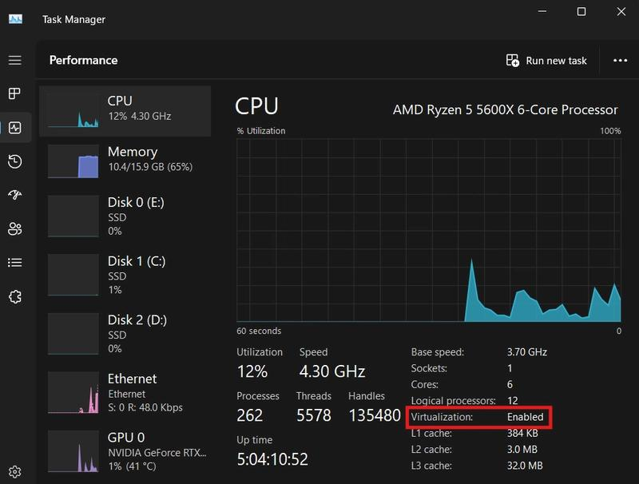

# Persiapan Perang

Di 2026 era programming sudah berubah, terutama karena AI, tapi disini saya ingin mengajarkan kalian cara menjadi programmer yang organik (independen dari bantuan), asumsi semisal tidak punya uang untuk pakai AI atau hidup dimana bantuan-bantuan itu ga bisa digapai maka ilmu ini sangat berguna.

## Kamu pasti menggunakan Windows

Windows merupakan sistem operasi yang dibuat untuk end-user (konsumer) biasanya dipakai untuk menjalankan media, file, dsb. Tapi untuk menjadi programmer kamu lebih baik beralih ke sistem operasi berstandar ***POSIX*** salah satunya ***linux*** ini akan berguna nanti karena 90% komputer di dunia menggunakan ***linux***.

## Linux

Linux adalah sistem operasi sumber terbuka (*open source*). Komponen intinya disebut **kernel** yang bertugas mengelola hardware dan menyediakan layanan aplikasi, seperti *process management*, *memory management*, *device management*, *filesystem operations*, *system calls*, *hardware communication*.

```
                        User space
    +---------------------------------------------------------+
    | shell/cmd  ---->  System library  ------>  Application  |
    +-----------------------------------+--^------------------+
                          Kernel        |  |
    +-----------------------------------|--|------------------+
    | +---------------------+           |  |                  |           
    | | manage program      |           |  |                  |
    | | manage memory       |           V  +                  |
    | | manage file         | ----> System Calls              |
    | | .....               |                                 |
    | +---------------------+                                 |
    +---------------------------------------------------------+
                         Hardware
    +---------------------------------------------------------+
    |       CPU             RAM             HARD-DRIVE        |
    +---------------------------------------------------------+
```

Distribusi linux disebut distro, yaitu paket sistem yang menggabungkan kernel dengna tools dan software yang dibutuhkan agar sistem dapat digunakan. Setiap distro memiliki pendekatan berbeda dalam pengelolaan software, package manager, pembaruan sistem dan konfigurasi bawaan.

Untuk course ini kita pakai **Debian**, karena:
* Stabil dan ekosistemnya tua
* Repository yang besar
* Dokumentasi yang baik
* Sangat cocok untuk pengembangan dan server
* Gratis dan sumber terbuka

## WSL

Di 2026 kamu tidak perlu menginstall sistem operasi linux secara terpisah seperti ***dual boot*** atau menggunakan ***virtual machine*** karena sekarang bisa digunakan di dalam sistem operasi Windows secara praktis dan langsung namun masih tetap dalam mesin virtual, namanya ***WSL (Windows Subsystem for Linux)***, jadi kmu masih bisa enak-enak menjadi konsumer sekaligus produksi dengan ***WSL***.

```
Arsitektur WSL2
                           +----------------------------+ 
    +-------------+        |    +------------------+    |
    |   Windows   |<----------->|    GNU/Linux     |    |
    |   usermode  |        |    |    usermode      |    |
    +------+------+        |    +---------+--------+    |
           |               |              |             |
    +------+------+        |    +---------+--------+    |
    | Windows NT  |        |    |   Linux Kernel   |    |
    +------+------+        |    +---------+--------+    |
           |               +--------------|-------------+
    +------+------------------------------+--------+
    |                 Hypervisor                   |
    +----------------------------------------------+
```

Anggap ini seperti emulator, dua OS di dalam satu komputer, jadi kita tidak perlu menghapus windows untuk belajar linux, dan apapun aplikasi yang di instal di linux tidak akan mempengaruhi windows.

Untuk menginstal ***WSL*** lakukan langkah-langkah berikut:

**Cek Hardware Virtualization**

* Ketik `CTRL+Shift+Esc` atau cari *Task Manager*
* Pilih `Performance` -> `GPU`
* Cari informasi `Virtualization: Enabled`



* Jika bertuliskan `Disabled` kamu perlu mengaktifkannya lewat BIOS/UEFI untuk caranya tergantung jenis komputer mu.

**Instal WSL**

* Ketik `terminal` pada pencarian di windows
* Klik pada ikon kotak dengan simbol `>_`


* Ketik:

```powershell
> wsl --install --no-distribution
```

* Tunggu hingga proses pengunduhan selesai
* **Restart** komputer
* Update WSL

```powershell
wsl --update
```

> Jika Microsoft Store tidak dapat digunakan, tersedia alternatif:

```powershell
wsl --update --web-download
```

* Set ke WSL2

```powershell
wsl --set-default-version 2
```

* verifikasi

```powershell
wsl --version
```

```powershell
wsl --status 
```

## Debian

* Cek distribusi apakah kosong?

```powershell
wsl --list --verbose
```

* Jika kosong (harusnya kosong) cek Debian

```powershell
wsl --list --online
```

* Cari kata *Debian*, jika ada saat nya instal

```powershell
wsl --install -d Debian
```

> Jika stuck atau gagal lakukan perintah `wsl --install --web-download -d Debian`

* Jalankan

```powershell
wsl -d Debian
```

Akan muncul tulisan

```
Installing, this may take a few minutes...
```

Tunggu hingga proses selesai.

* Masukan *username* baru lalu tekan *Enter*
* Masukan *password* baru lalu tekan *Enter*

> Karakter pengetikan tidak terlihat di layar, itu normal.

* Ketik ulang *password* lalu tekan *Enter*. Maka terminal akan terlihat seperti ini:

```bash
usernameKamu@computer-nameMu:~$
```

## Belajar Syntax Linux Sederhana

Disini kita akan menggunakan perintah linux sederhana yang biasa dan wajib dilakukan setiap kita berada di mesin linux baru.

* Ketik `whoami`

```bash
$ whoami
```

akan memunculkan username sekarang

* cek versi

```bash
$ cat /etc/os-release
```

Atau

```bash
$ cat /etc/debian_version
```

* Masuk sebagai root (Administrator)

```bash
$ sudo
```

> Masukan password mu tadi

Ini merupakan perintah sensitif karena sudo (superuser do) adalah perintah administratif yang bisa melakukan apapun, tips untuk kegiatan sehari-hari gunakan perintah biasa saja jangan sudo.

* Mengecek lokasi cursor sekarang dengan `pwd` (*print working directory*)

```bash
$ pwd
```

* Keluar dari wsl

```bash
$ exit
```

* Untuk masuk lagi nanti bisa Ketik

```powershell
> wsl
```

* Jika ingin masuk ke Debian tapi lupa password root

```powershell
> wsl -d Debian -u root
```

Lalu reset password baru

```bash
$ passwd username
```


