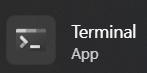

# Persiapan Perang

Di 2026 era programming sudah berubah, terutama karena AI, tapi disini saya ingin mengajarkan kalian cara menjadi programmer yang organik (independen dari bantuan), asumsi semisal tidak punya uang untuk pakai AI atau hidup dimana bantuan-bantuan itu ga bisa digapai maka ilmu ini sangat berguna.

## Kamu pasti menggunakan Windows

Windows merupakan sistem operasi yang dibuat untuk end-user (konsumer) biasanya dipakai untuk menjalankan media, file, dsb. Tapi untuk menjadi programmer kamu lebih baik beralih ke sistem operasi berstandar ***POSIX*** salah satunya ***linux*** ini akan berguna nanti karena 90% komputer di dunia menggunakan ***linux***. 

## WSL

Di 2026 kamu tidak perlu menginstall sistem operasi linux secara terpisah seperti ***dual boot*** atau menggunakan ***virtual machine*** karena sekarang bisa digunakan di dalam sistem operasi Windows secara praktis dan langsung namun masih tetap dalam mesin virtual, namanya ***WSL (Windows Subsystem for Linux)***, jadi kmu masih bisa enak-enak menjadi konsumer sekaligus produksi dengan ***WSL***.

Di windows terdapat terminal atau console yang disebut ***powershell***, alat ini sering di gunakan oleh programmer untuk melakukan rekayasa perangkat lunak dan menulis software, jika kamu ingin menjadi programmer kamu harus terbiasa dengan ini 

Untuk menginstal ***WSL*** lakukan langkah-langkah berikut:

* Ketik `terminal` pada pencarian di windows
* Klik pada ikon kotak dengan simbol `>_`



* Ketik:

```powershell
> wsl --install -d Debian
```

> Jika wsl sudah ada di mesin (*biasanya tidak ada*) cek terlebih dahulu mesin yang tersedia dengan `wsl --list` jika tidak ada, lakukan langkah diatas

* Tunggu hingga proses pengunduhan selesai
* **Restart** komputer

> Setelah komputer menyala, jendela terminal Debian akan muncul sendiri, jika tidak cari aplikasi **Debian** di Menu Start.

* Masukan *username* baru lalu tekan *Enter*
* Masukan *password* baru lalu tekan *Enter*

> Karakter pengetikan tidak akan muncul di layar, jadi bayangkan sendiri

* Ketik ulang *password* lalu tekan *Enter*
* Verifikasi:

```powershell
> wsl --list --verbose
```

> Pastikan kolom `VERSION` menunjukan angka **2**, jika masih **1** ubah dengan `wsl --set-version Debian 2`.

* Masuk ke WSL

```powershell
> wsl
```

* cek rilis

```bash
$ cat /etc/os-release
```

> Pastikan output yang muncul menampilkan VERSION="13(trixie)"


